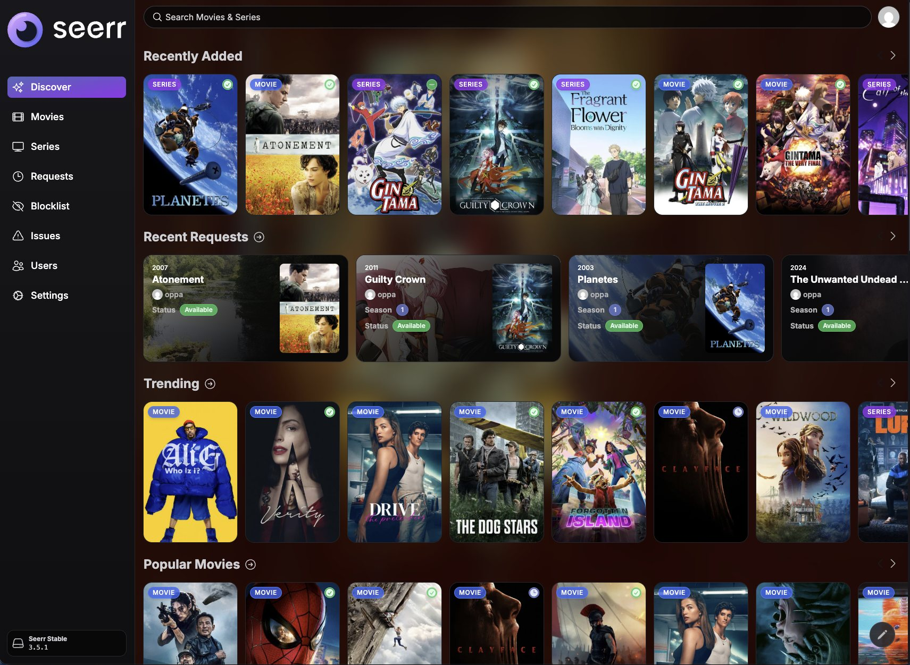
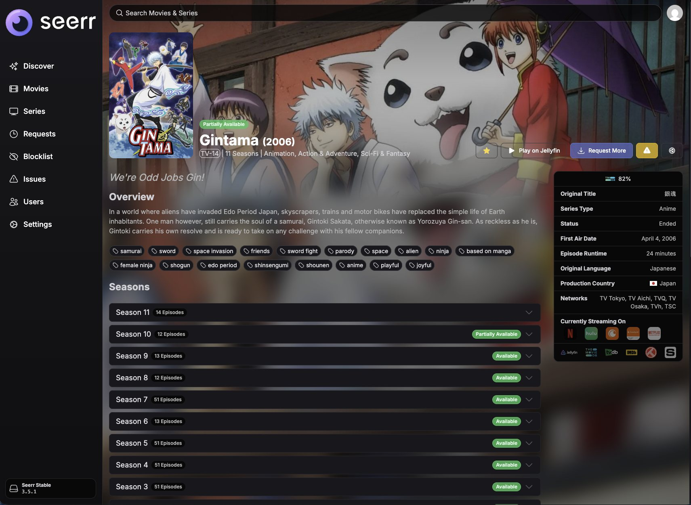
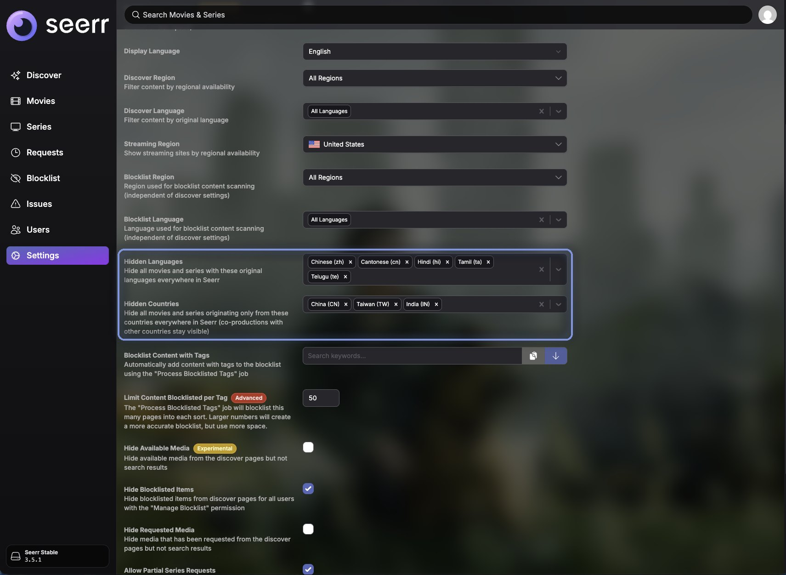

[](https://discord.gg/ncKmDEArqg)

> [!IMPORTANT]
> **This is a personal fork of [seerr-team/seerr](https://github.com/seerr-team/seerr), not the official Seerr.**
> It is built for my own home server and deviates from upstream as described below. It is not supported by the Seerr
> team, and you should use the [official project](https://github.com/seerr-team/seerr) unless you specifically want
> these changes. Please do not report issues from this fork upstream.

## About this fork

`main` is the latest upstream release (currently **v3.5.1**) plus the commits below, and is the only branch. A GitHub
Action builds a Docker image from it on every push (see [Use the prebuilt image](#use-the-prebuilt-image)).

<p align="center">

</p>

### Deviations from upstream

- **Hidden Languages and Hidden Countries** (Settings > General). Hides movies and series by original language or
  origin country everywhere in Seerr: discover, trending, search, recommendations, similar titles, collections and
  person credits. Filtering is done server-side. A country only hides a title when _all_ of its origin countries are
  hidden, so co-productions with other countries stay visible. Not part of upstream (see
  [seerr-team/seerr#1687](https://github.com/seerr-team/seerr/issues/1687)).
- **Kaleidochromic theme.** The Tailwind `gray`, `indigo` and `purple` scales are remapped to the palette of the
  Kaleidochromic theme from my [Jellyfin ThemeSwitcher plugin](https://github.com/oppahansi/themeswitcher), the UI
  font is a self-hosted Quicksand, and corners are rounder.
- **Random blurred background** behind every page that has no backdrop of its own. A random trending backdrop is
  picked on each navigation and fades in. Movie, series, collection and issue pages keep their own backdrop.
- **Media pages fade into a blurred backdrop.** On movie, series, collection and issue pages the sharp banner at the top
  dissolves into a blurred, dimmed copy of the same image instead of fading to solid dark.

<p align="center">


</p>

### Use the prebuilt image

A GitHub Action builds a multi-architecture image (`linux/amd64` and `linux/arm64`) from `main` and publishes it to the
GitHub Container Registry as **`ghcr.io/oppahansi/seerr`**. Use it in place of the official image, for example in a
Docker Compose file:

```yaml
services:
  seerr:
    image: ghcr.io/oppahansi/seerr:latest
    init: true
    container_name: seerr
    environment:
      - TZ=Europe/Berlin
      - PORT=5055
    ports:
      - 5055:5055
    volumes:
      - config:/app/config
    restart: unless-stopped
volumes:
  config:
```

| Tag           | Meaning                                                                      |
| ------------- | ---------------------------------------------------------------------------- |
| `latest`      | The most recent build of `main`                                              |
| `3.5.1`       | The upstream version `main` is based on (moves with each build of that base) |
| `sha-abcdef0` | One specific commit, for pinning                                             |

To update, run `docker compose pull && docker compose up -d`.

The configuration and database live in the `config` volume and are compatible with upstream Seerr, so you can switch
between this fork and the official image. Back up the `config` volume before upgrading. For all other configuration
(reverse proxy, PostgreSQL, environment variables) see the [upstream documentation](https://docs.seerr.dev).

### Build the image yourself

If you would rather not use the prebuilt image, build it from this repository's `Dockerfile` on the machine that runs
it (or pass `--platform` to build for another architecture):

```bash
git clone https://github.com/oppahansi/seerr.git
cd seerr
docker build --build-arg COMMIT_TAG=$(git rev-parse HEAD) -t seerr-custom:local .
```

Then use `image: seerr-custom:local` and `pull_policy: never` in the Compose file above, so Docker does not try to pull
the local tag from a registry. To update, pull the new commits, rebuild with the same tag and recreate the container
(`docker compose up -d --force-recreate`).

### Updating to a new upstream release

```bash
git remote add upstream https://github.com/seerr-team/seerr.git   # once
git fetch upstream --tags
git log --oneline vOLD..main                                      # the fork commits to carry over
git checkout -b main-next vNEW                                    # the new upstream release tag
git cherry-pick <fork commits>
git push --force-with-lease origin main-next:main
```

Pushing to `main` builds and publishes the new image.

---

<p align="center">

</p>
<p align="center">


</p>
<p align="center">
<a href="https://discord.gg/seerr"></a>
<a href="https://hub.docker.com/r/seerr/seerr"></a>
<a href="https://translate.seerr.dev/engage/seerr/"></a>
<a href="https://github.com/seerr-team/seerr/blob/develop/LICENSE"></a>

**Seerr** is a free and open source software application for managing requests for your media library. It integrates with the media server of your choice: [Jellyfin](https://jellyfin.org), [Plex](https://plex.tv), and [Emby](https://emby.media/). In addition, it integrates with your existing services, such as **[Sonarr](https://sonarr.tv/)**, **[Radarr](https://radarr.video/)**.

## Current Features

- Full Jellyfin/Emby/Plex integration including authentication with user import & management.
- Support for **PostgreSQL** and **SQLite** databases.
- Supports Movies, Shows and Mixed Libraries.
- Ability to change email addresses for SMTP purposes.
- Easy integration with your existing services. Currently, Seerr supports Sonarr and Radarr. More to come!
- Jellyfin/Emby/Plex library scan, to keep track of the titles which are already available.
- Customizable request system, which allows users to request individual seasons or movies in a friendly, easy-to-use interface.
- Incredibly simple request management UI. Don't dig through the app to simply approve recent requests!
- Granular permission system.
- Support for various notification agents.
- Mobile-friendly design, for when you need to approve requests on the go!
- Support for watchlisting & blocklisting media.

With more features on the way! Check out our [issue tracker](/../../issues) to see the features which have already been requested.

## Getting Started

Check out our documentation for instructions on how to install and run Seerr:

https://docs.seerr.dev/getting-started/

## Preview


## Migrating from Overseerr/Jellyseerr to Seerr

Read our [release announcement](https://docs.seerr.dev/blog/seerr-release) to learn what Seerr means for Jellyseerr and Overseerr users.

Please follow our [migration guide](https://docs.seerr.dev/migration-guide) for detailed instructions on migrating from Overseerr or Jellyseerr.

## Support

- Check out the [Seerr Documentation](https://docs.seerr.dev) before asking for help. Your question might already be in the docs!
- You can get support on [Discord](https://discord.gg/seerr).
- You can ask questions in the Help category of our [GitHub Discussions](/../../discussions).
- Bug reports and feature requests can be submitted via [GitHub Issues](/../../issues).

## API Documentation

You can access the API documentation from your local Seerr install at http://localhost:5055/api-docs

## Community

You can ask questions, share ideas, and more in [GitHub Discussions](/../../discussions).

If you would like to chat with other members of our growing community, [join the Seerr Discord server](https://discord.gg/seerr)!

Our [Code of Conduct](./CODE_OF_CONDUCT.md) applies to all Seerr community channels.

## Contributing

You can help improve Seerr too! Check out our [Contribution Guide](./CONTRIBUTING.md) to get started.

## Contributors ✨

[](https://opencollective.com/seerr/#backers)

[](https://opencollective.com/seerr/#backers)
[](https://opencollective.com/seerr/#sponsors)
